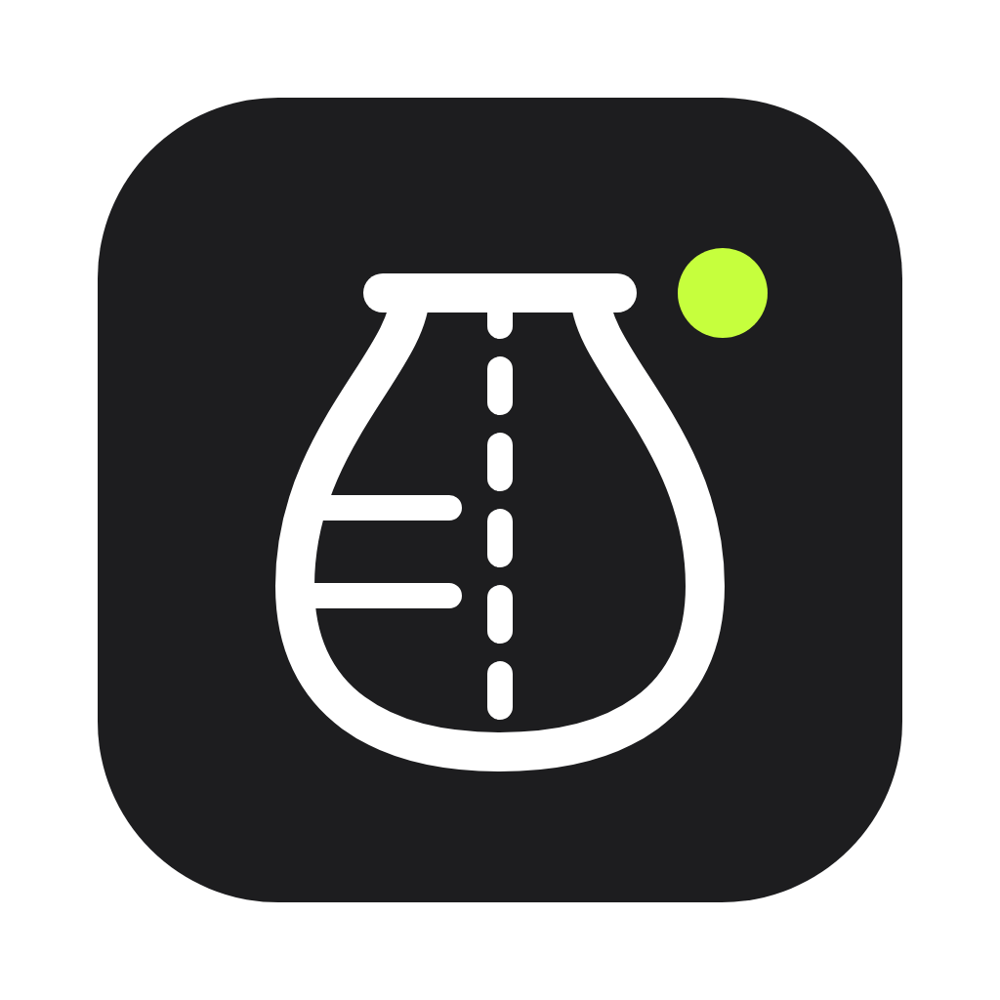
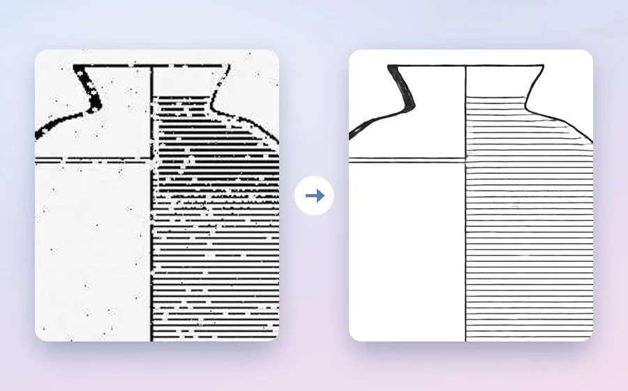
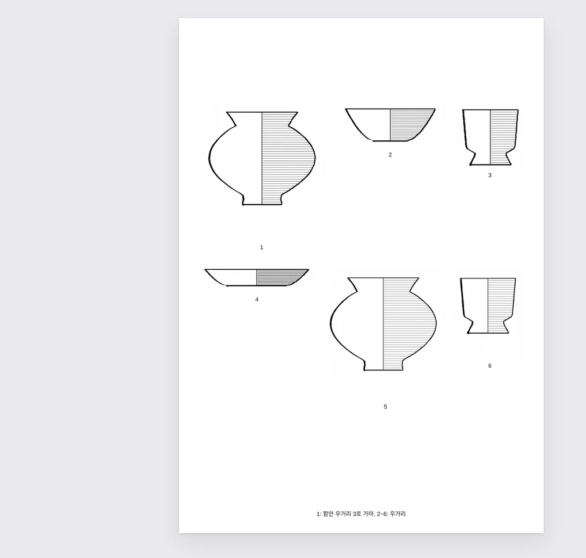
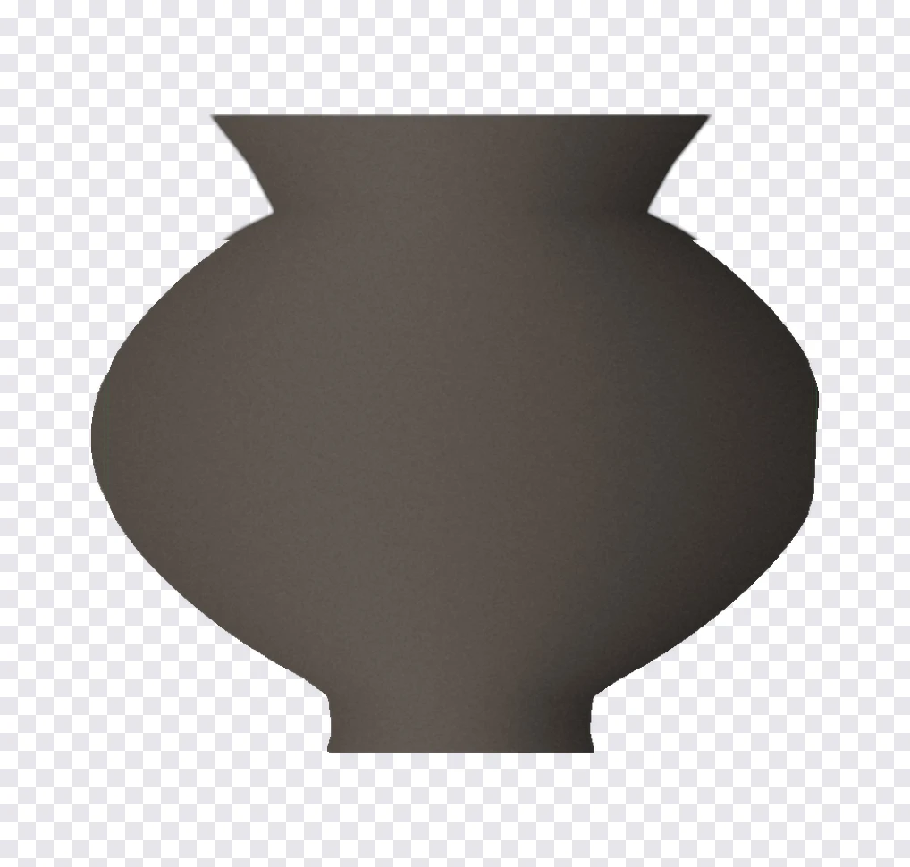

<div align="center">



<h1 align="center">ArchaeoPlate Studio</h1>
<h3 align="center">고고학 도판 편집기</h3>

<strong>Archaeological Plate Editor · 考古学図版エディタ</strong>


<sub>日本語をご利用の方は、<a href="#05-english--日本語"><b>05. English / 日本語</b></a> の「日本語」を開いてください。</sub>

<br>

<a href="https://archstudio-hs.github.io/archaeoplate-studio/app/"></a><a href="https://github.com/archstudio-hs/archaeoplate-studio/releases/latest/download/ArchaeoPlateStudio-Windows.exe"></a><a href="https://github.com/archstudio-hs/archaeoplate-studio/releases/latest/download/ArchaeoPlateStudio-Mac.zip"></a><br><a href="docs/manual.pdf"></a>

</div>

---

## 01. 소개

**ArchaeoPlate Studio**는 고고학 연구자를 위한 도판 제작 프로그램입니다.

발굴조사 보고서에서 도면을 추출해 축척을 조정하고, 유물 사진의 배경을 제거한 뒤, 원하는 크기와 배열로 배치하여 도판을 제작할 수 있습니다. **원본 선택부터 편집과 출력까지** 하나의 작업 공간에서 처리하도록 설계했습니다.

### 1.1 주요 기능

| 기능 | 설명 |
|:---|:---|
| **실측도 편집** | PDF·이미지에서 도면 추출, 스케일바 OCR 인식, 수동 측정 및 목표 축척 설정 |
| **유물 사진 편집** | AI 배경 제거 및 수동 보정 |
| **도판 제작** | 유물 자동 배치, 번호·캡션 입력, 크기·간격·회전·반전 편집 |
| **고해상도 출력** | SVG·PNG·JPEG·PDF 저장, 여러 도판 ZIP 일괄 출력(PDF는 여러 쪽 한 파일) |

### 1.2 작업 과정

<table width="100%">
  <tr>
    <td align="center" width="33%">
      <b>STEP 01</b><br>
      <strong>원본 선택</strong><br>
      <sub>PDF·이미지 불러오기</sub>
    </td>
    <td align="center" width="34%">
      <b>STEP 02</b><br>
      <strong>도판 설정</strong><br>
      <sub>축척·용지·배치 설정</sub>
    </td>
    <td align="center" width="33%">
      <b>STEP 03</b><br>
      <strong>편집 및 저장</strong><br>
      <sub>번호·캡션·고해상도 출력</sub>
    </td>
  </tr>
</table>

> **자료 처리 방식**
>
> PDF 읽기, OCR 및 AI 배경 제거는 사용자의 컴퓨터에서 처리하며, 원본 자료를 별도의 처리 서버로 전송하지 않습니다. AI 모델은 처음 사용할 때 다운로드가 필요할 수 있습니다.

### 1.3 연구 중: 도면 복원 AI



<sub>손상 모의 도면(왼쪽)과 복원 결과(오른쪽). 도면은 시연용으로 그린 합성 도면이며, 오른쪽은 실제 모델 출력입니다.</sub>

옛 발굴조사 보고서의 뭉개지고 끊긴 실측도를 **선명한 선으로 되살리는 가벼운 AI**를 연구하고 있습니다. 편집기에 ‘도면 복원’ 기능으로 넣을 예정이며, 지금은 시험 중입니다.

| 항목 | 내용 |
|:---|:---|
| **모델** | 2배 확대 선 복원 전용 소형 모델 두 가지 — small 0.99 MB, base 2.4 MB (처음부터 직접 학습) |
| **실행** | 웹 브라우저 안에서, 사용자의 컴퓨터로만 처리 |
| **학습 자료** | 직접 정리한 깨끗한 실측도 444장 + 옛 스캔 손상 모의 |
| **시험 결과** | 시험 도면 24장(240조각), 선 일치도 F1: 단순 확대 71.9 → small 90.2 · base 90.8 |
| **탁본** | 자동 판별 대신 사용자가 범위를 지정하고, 지정한 곳은 원본 유지 |


---

## 02. 시작하기

### 2.1 이용 방법

| 이용 환경 | 바로가기 | 사용 방법 |
|:---|:---|:---|
| **웹** | **[웹 편집기 열기](https://archstudio-hs.github.io/archaeoplate-studio/app/)** | 설치 없이 Chrome·Edge에서 실행 |
| **Windows 10·11** | **[Windows용 다운로드 (.exe)](https://github.com/archstudio-hs/archaeoplate-studio/releases/latest/download/ArchaeoPlateStudio-Windows.exe)** | 파일을 내려받아 실행 |
| **macOS 11 이상** | **[macOS용 다운로드 (.zip)](https://github.com/archstudio-hs/archaeoplate-studio/releases/latest/download/ArchaeoPlateStudio-Mac.zip)** | 압축 해제 후 앱을 응용 프로그램 폴더로 이동 |

웹 버전은 처음 실행할 때 페이지가 한 번 새로고침될 수 있습니다.

> **데스크톱 앱 안내**
>
> Windows·macOS 설치형 버전에는 코드 서명이 적용되지 않아 다운로드 또는 최초 실행 시 보안 경고가 나타날 수 있습니다. 학교·기관 PC에서 앱 실행이 제한되는 경우 웹 버전을 이용할 수 있습니다.

### 2.2 다운로드 및 실행 문제 해결

<details>
<summary><b>Chrome · Edge · Windows · macOS 문제 해결 방법 보기</b></summary>

<br>

**① 브라우저에서 다운로드가 차단되는 경우**

- **Chrome:** 오른쪽 위 다운로드 목록에서 해당 파일의 경고 내용을 확인합니다. 다운로드를 계속할 수 있는 옵션이 표시되는 경우, 공식 GitHub Releases의 파일인지 확인한 뒤 선택합니다.
- **Edge:** 다운로드 목록에서 해당 파일의 `···` 메뉴를 열어 경고 내용을 확인합니다. `유지` 또는 추가 옵션이 표시되는 경우, 파일의 출처를 확인한 뒤 선택할 수 있습니다.
- 경고의 종류와 브라우저 정책에 따라 해당 옵션이 나타나지 않을 수도 있습니다.

**② Windows에서 실행이 차단되는 경우**

- **Microsoft Defender SmartScreen**에서 `Windows의 PC 보호` 메시지가 나타날 수 있습니다.
- 신뢰할 수 있는 배포 파일인 경우, `추가 정보` 또는 `자세한 정보`를 선택하면 `실행` 옵션이 나타날 수 있습니다.
- **Smart App Control**이나 기관 보안 정책에 의해 차단된 경우에는 개별 실행 허용 옵션이 없을 수 있습니다. 이때는 웹 버전을 이용하세요.

**③ macOS에서 실행이 차단되는 경우**

1. 압축을 해제한 앱을 `응용 프로그램` 폴더로 옮깁니다.
2. 개발자를 확인할 수 없다는 안내가 나타나면 창을 닫습니다.
3. **시스템 설정 → 개인정보 보호 및 보안**을 엽니다.
4. 해당 앱에 대한 **그래도 열기**가 표시되는 경우 선택하고, 안내에 따라 인증합니다.

**‘앱이 손상되어 열 수 없습니다’라고 나오는 경우**

먼저 공식 [GitHub Releases](https://github.com/archstudio-hs/archaeoplate-studio/releases)에서 파일을 다시 내려받아 확인하세요. 실제로 파일이 손상되었을 수도 있으므로, 이 경고가 반드시 코드 서명 문제를 뜻하는 것은 아닙니다.

다운로드한 파일이 정상이고 macOS의 격리 속성만 문제인 것으로 확인된 경우에 한해, 터미널에서 아래 명령을 사용할 수 있습니다. **실제 앱 이름이 다르면 경로도 바꿔야 합니다.**

```bash
xattr -dr com.apple.quarantine "/Applications/고고학 도판 편집기.app"
```

이 명령은 macOS의 격리 보호를 해제하므로 주의해서 사용하세요.

**④ 학교·기관 컴퓨터에서 앱 실행이 제한되는 경우**

[웹 편집기](https://archstudio-hs.github.io/archaeoplate-studio/app/)를 이용하세요. 단, 기관의 브라우저·보안 설정에 따라 웹 기능도 일부 제한될 수 있습니다.

</details>

### 2.3 다른 환경에서 작업 이어가기

<details>
<summary><b>프로젝트 파일 저장·불러오기</b></summary>

<br>

1. 작업 중인 프로그램에서 **프로젝트 → 프로젝트 파일 저장**을 선택합니다.
2. 저장한 프로젝트 파일을 다른 컴퓨터나 실행 환경으로 옮깁니다.
3. **프로젝트 불러오기**를 선택해 이어서 편집합니다.

</details>

---

## 03. 작업 결과

<table width="100%">
  <tr>
    <th align="center" width="50%">실측도 도판</th>
    <th align="center" width="50%">AI 배경 제거</th>
  </tr>
  <tr>
    <td align="center" valign="middle">
      <a href="docs/img/plate.webp"></a>
    </td>
    <td align="center" valign="middle">
      <a href="docs/img/cutout.webp"></a>
    </td>
  </tr>
  <tr>
    <td align="center"><sub>축척을 조정한 유물 도면 배치</sub></td>
    <td align="center"><sub>배경 제거 및 수동 보정</sub></td>
  </tr>
</table>

---

## 04. 사용 환경 및 문서

### 4.1 권장 환경

| 항목 | 지원 및 권장 사항 |
|:---|:---|
| **웹 브라우저** | 데스크톱 Chrome·Edge 최신 버전 |
| **Windows** | Windows 10·11 |
| **macOS** | macOS 11 이상 |
| **화면 크기** | 가로 1280px 이상 권장 |
| **모바일·태블릿** | 현재 미지원 |
| **Firefox·Safari** | 미검증 |

### 4.2 관련 문서

| 문서 | 내용 |
|:---|:---|
| **[사용 설명서 (한국어)](docs/manual.pdf)** | 기능 및 사용 방법 |
| **[操作マニュアル（日本語）](docs/manual-ja.pdf)** | 일본어 사용 설명서 |
| [서드파티 라이선스](THIRD_PARTY_NOTICES.md) | 외부 라이브러리·AI 모델 관련 고지 |
| [라이선스](LICENSE.md) | 프로그램 이용·수정·재배포 조건 |

---

## 05. English / 日本語

<details>
<summary><b>English — Introduction</b></summary>

<br>

**ArchaeoPlate Studio · Archaeological Plate Editor**

ArchaeoPlate Studio is a browser-based and desktop application for creating archaeological plates from excavation-report drawings and artifact photographs. It supports PDF drawing extraction, OCR-assisted scale calibration, AI background removal with manual refinement, artifact layout, and high-resolution export (SVG, PNG, JPEG, PDF).

**In research:** a lightweight in-browser AI (0.99–2.4 MB) that restores blurred, broken line drawings from older excavation reports.

Source materials are processed on the user's device rather than uploaded to an external processing server. The AI model may require an initial download.

**Get started:** [Web editor](https://archstudio-hs.github.io/archaeoplate-studio/app/) · [Windows](https://github.com/archstudio-hs/archaeoplate-studio/releases/latest/download/ArchaeoPlateStudio-Windows.exe) · [macOS](https://github.com/archstudio-hs/archaeoplate-studio/releases/latest/download/ArchaeoPlateStudio-Mac.zip) · [Manual](docs/manual.pdf)

**Requirements:** Desktop Chrome or Edge recommended; screen width 1280px or greater.

**License:** [PolyForm Strict License 1.0.0](LICENSE.md) — noncommercial use permitted; modification and redistribution are not permitted under the license.

</details>

<details>
<summary><b>日本語 — 概要・ダウンロード・使い方</b></summary>

<br>

### ArchaeoPlate Studio

**考古学図版エディタ**

ArchaeoPlate Studioは、考古学研究者向けの図版作成ツールです。発掘調査報告書から図面を抽出して縮尺を調整し、遺物写真の背景を除去したうえで、図版の配置・編集・出力まで一つの作業環境で行えます。

| 主な機能 | 内容 |
|:---|:---|
| **実測図の編集** | PDF・画像から図面を抽出し、スケールバーのOCR認識または手動計測で縮尺を設定 |
| **遺物写真の編集** | AIによる背景除去と手動補正 |
| **図版の作成** | 遺物の自動配置、番号・キャプション、サイズ・間隔・回転・反転の編集 |
| **高解像度出力** | SVG・PNG・JPEG・PDF、ZIP形式での一括保存（PDFは複数ページを1ファイルに） |

### ダウンロード・利用方法

<div align="center">

<a href="https://archstudio-hs.github.io/archaeoplate-studio/ja/app/"></a><a href="https://github.com/archstudio-hs/archaeoplate-studio/releases/latest/download/ArchaeoPlateStudio-JA-Windows.exe"></a><a href="https://github.com/archstudio-hs/archaeoplate-studio/releases/latest/download/ArchaeoPlateStudio-JA-Mac.zip"></a><br><a href="docs/manual-ja.pdf"></a>

</div>

| 利用環境 | 説明 |
|:---|:---|
| **Web版** | インストール不要。デスクトップ版Chrome・Edgeを推奨。初回にページが再読み込みされる場合があります。 |
| **Windows 10・11** | `.exe`ファイルをダウンロードして実行します。 |
| **macOS 11以降** | `.zip`ファイルを解凍し、アプリを「アプリケーション」フォルダーに移動します。 |

> **データの処理**
>
> PDFの読み込み、OCR、AIによる背景除去は利用者の端末上で行われ、元資料は外部の処理サーバーに送信されません。AIモデルは初回使用時にダウンロードが必要となる場合があります。

> **デスクトップ版について**
>
> Windows版・macOS版はコード署名されていないため、ダウンロード時や初回起動時にセキュリティ警告が表示される場合があります。

<details>
<summary><b>Windows・macOS版のダウンロード・起動時のトラブル対処法</b></summary>

<br>

**① ブラウザーでダウンロードがブロックされる場合**

- **Chrome：** 右上のダウンロード一覧を開き、該当ファイルの警告内容を確認します。続行する項目が表示された場合は、公式GitHub Releasesのファイルであることを確認したうえで選択してください。
- **Edge：** ダウンロード一覧の該当ファイルで `···` メニューを開きます。`保持` などの項目が表示された場合は、配布元を確認して選択してください。
- 警告の種類やブラウザーの設定によっては、続行の項目が表示されない場合があります。

**② Windowsで起動がブロックされる場合**

- Microsoft Defender SmartScreenによって「WindowsによってPCが保護されました」という警告が出る場合があります。
- 信頼できる配布ファイルである場合、`詳細情報` から `実行` を選べることがあります。
- Smart App Controlや所属機関のセキュリティポリシーによる制限では、この操作ができない場合があります。その場合はWeb版をご利用ください。

**③ macOSで起動がブロックされる場合**

1. 解凍したアプリを「アプリケーション」フォルダーに移動します。
2. 開発元を確認できないという警告が出た場合は、いったん閉じます。
3. **システム設定 → プライバシーとセキュリティ**を開きます。
4. 該当アプリの**「このまま開く」**が表示された場合は選択し、案内に従って認証します。

**「アプリが壊れているため開けません」と表示される場合**

まず公式の[GitHub Releases](https://github.com/archstudio-hs/archaeoplate-studio/releases)から再ダウンロードしてください。ファイル自体が破損している可能性もあります。

ファイルが正常で、macOSの隔離属性のみが原因であると確認できた場合に限り、以下のコマンドを使用できます。**実際のアプリ名が異なる場合はパスを変更してください。**

```bash
xattr -dr com.apple.quarantine "/Applications/考古学図版エディタ.app"
```

このコマンドはmacOSの隔離保護を解除するため、注意して実行してください。

**④ 大学・研究機関のパソコンで実行できない場合**

[Web版エディタ](https://archstudio-hs.github.io/archaeoplate-studio/ja/app/)をご利用ください。ただし、所属機関のセキュリティ設定によってはWeb版の一部機能も制限される場合があります。

</details>

<details>
<summary><b>別の環境で作業を引き継ぐ方法</b></summary>

<br>

1. 作業中のプログラムで**「プロジェクト → プロジェクトファイルを保存」**を選択します。
2. 保存したファイルを別のパソコンや環境に移動します。
3. **「プロジェクトを読み込む」**から編集を再開します。

</details>

**研究中：図面復元AI** — 古い発掘調査報告書の、つぶれたり途切れたりした実測図の線を鮮明に復元する軽量AI（0.99～2.4 MB、ブラウザー内で処理）を研究しています。テスト図面24枚（240片）で線の一致度F1は単純拡大71.9に対し90.2～90.8でした。今後「図面復元」機能として追加する予定です。

**推奨環境：** デスクトップ版Chrome・Edge、画面幅1280px以上。スマートフォン・タブレットには現在対応していません。

**関連資料：** [操作マニュアル](docs/manual-ja.pdf) · [第三者ライセンス](THIRD_PARTY_NOTICES.md) · [ライセンス](LICENSE.md)

**ライセンス：** PolyForm Strict License 1.0.0。非商用利用は許可されますが、改変・再配布は認められていません。詳細は[LICENSE.md](LICENSE.md)をご確認ください。

</details>

---

## 06. 라이선스

**[PolyForm Strict License 1.0.0](LICENSE.md)**

개인 연구·학습 및 대학·박물관·공공 연구기관 등에서의 비상업적 사용을 허용합니다. **프로그램의 수정·재배포·상업적 이용은 허용하지 않습니다.** 별도의 허가가 필요한 경우 저작권자에게 문의해 주세요.

외부 라이브러리와 AI 모델의 라이선스는 [THIRD_PARTY_NOTICES.md](THIRD_PARTY_NOTICES.md)를 참고해 주세요. 세부 조건은 [LICENSE.md](LICENSE.md)의 원문이 우선합니다.

---

<div align="center">

<strong>ArchaeoPlate Studio</strong><br>
<sub>Archaeological Research &amp; Digital Documentation</sub><br><br>
<sub>© 2026 Kim Hyun Soo · <a href="https://github.com/archstudio-hs">@archstudio-hs</a></sub>

</div>
